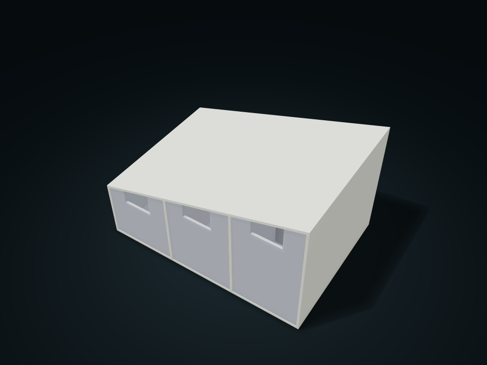

# Sloped-Top Drawer Box

Drawers of different heights are generated column by column to fit a sloped-top space, with compartments following each drawer.

**[Preview this model and customize it on boxesmodel](https://boxesmodel.com/models/stair-gap-bin)**

## Default model

| Property | Value |
| --- | --- |
| Category | Drawer Storage |
| Model version | 1.0.0 |
| Default assembly display size | 200 × 140 × 120 mm |
| Included parts | 4 |
| Formats | STL and STEP |
| Units | Millimeters |

Covers the layout of all parts in the current preview; see Files and dimensions for each part's print size.

## Dimensions and features

| Detail | Default value |
| --- | --- |
| Top wall normal thickness | 2.4 mm |
| Clear width per drawer | 57.9 mm |

## Download the parts

Open a file below and choose **Download raw file** on GitHub. STL is for slicers; STEP is for CAD editing.

| Part | Dimensions | STL | STEP |
| --- | --- | --- | --- |
| Sloped-top cabinet | 200 × 140 × 120 mm | [cabinet.stl](cabinet.stl) | [cabinet.step](cabinet.step) |
| Angled-front drawer 1 | 62.67 × 136.8 × 74.33 mm | [drawer-1.stl](drawer-1.stl) | [drawer-1.step](drawer-1.step) |
| Angled-front drawer 2 | 62.67 × 136.8 × 94.09 mm | [drawer-2.stl](drawer-2.stl) | [drawer-2.step](drawer-2.step) |
| Angled-front drawer 3 | 62.67 × 136.8 × 113.85 mm | [drawer-3.stl](drawer-3.stl) | [drawer-3.step](drawer-3.step) |

Each listed part has its own STL and STEP file. Preview colors are illustrative; the manufacturing files do not contain the displayed colors.

## Printing and assembly

- For spaces with a sloped top; the low side is on the left; drawers from different columns are not interchangeable.
- Pulls fully out at the front, supported underneath and stopped at the back; no anti-separation lock. Check cabinet bridging and supports when slicing, and test-print to check load-bearing first.
- Import at millimeter scale. Check your build volume, orientation, overhangs, supports and mating clearances in the slicer.

## Adjust the design

Visit the [interactive model page](https://boxesmodel.com/models/stair-gap-bin) to inspect the 3D model and adjust the available dimensions and layout options. This folder contains the default-size export shown above; custom exports follow the options and pricing shown on boxesmodel.

## License and attribution

Copyright © 2026 boxesmodel. These model files, preview and description are licensed under [CC BY 4.0](https://creativecommons.org/licenses/by/4.0/). You may share, modify and use them commercially with the required attribution. See the [full license](../../LICENSE) and [attribution guide](../../ATTRIBUTION.md).

Suggested credit:

> “Sloped-Top Drawer Box” by [boxesmodel](https://boxesmodel.com/models/stair-gap-bin), licensed under [CC BY 4.0](https://creativecommons.org/licenses/by/4.0/). Indicate any changes you make.

[Browse all models](../../CATALOG.md) · [About the collection](../../README.md)
