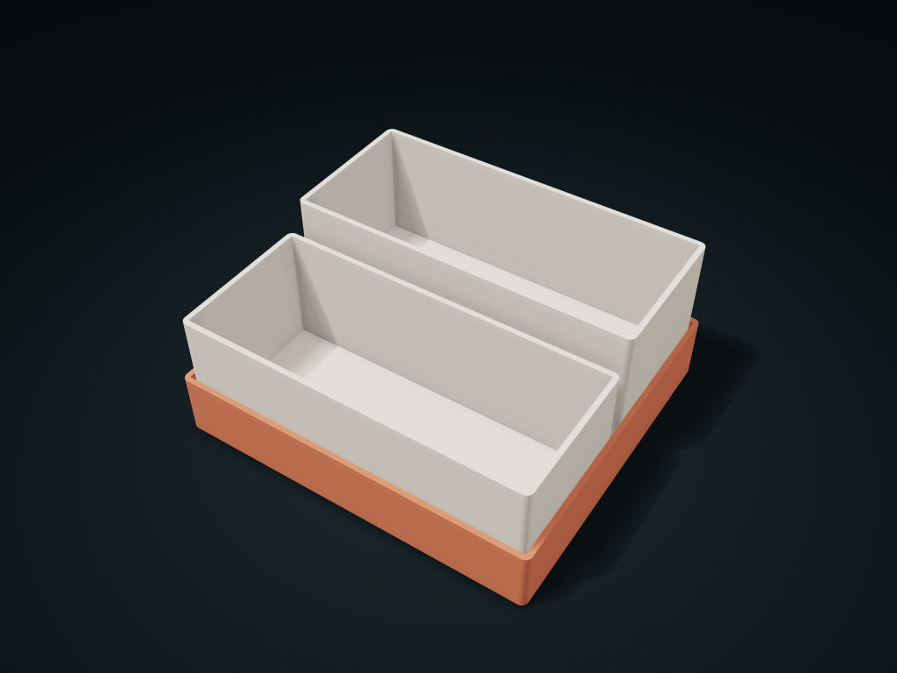

# Staggered Two-Cup Lift-Out Box

Front and rear square cups sit on ledges at different heights and lift out separately without blocking each other.

**[Preview this model and customize it on boxesmodel](https://boxesmodel.com/models/stair-step-lift-caddy)**

## Default model

| Property | Value |
| --- | --- |
| Category | Stackable Storage |
| Model version | 1.0.0 |
| Default assembly display size | 160 × 145 × 70 mm |
| Included parts | 3 |
| Formats | STL and STEP |
| Units | Millimeters |

Covers the layout of all parts in the current preview; see Files and dimensions for each part's print size.

## Download the parts

Open a file below and choose **Download raw file** on GitHub. STL is for slicers; STEP is for CAD editing.

| Part | Dimensions | STL | STEP |
| --- | --- | --- | --- |
| Stepped outer seat | 160 × 145 × 28 mm | [body.stl](body.stl) | [body.step](body.step) |
| Separate cup 1 | 154 × 66.5 × 55.6 mm | [cup-1.stl](cup-1.stl) | [cup-1.step](cup-1.step) |
| Separate cup 2 | 154 × 66.5 × 55.6 mm | [cup-2.stl](cup-2.stl) | [cup-2.step](cup-2.step) |

Each listed part has its own STL and STEP file. Preview colors are illustrative; the manufacturing files do not contain the displayed colors.

## Printing and assembly

- The outer seat and both cups print flat side down separately, with no hardware. The rear cup sits on a raised ledge and the front cup on the floor; lift the cups out one by one, with gaps between cups for access.
- Units are millimeters; matching parts use files generated in the same export. Set clearance by your items' maximum size and leave room to take them in and out.
- Check orientation and supports before printing, and test-print key mating parts first.
- Import at millimeter scale. Check your build volume, orientation, overhangs, supports and mating clearances in the slicer.

## Adjust the design

Visit the [interactive model page](https://boxesmodel.com/models/stair-step-lift-caddy) to inspect the 3D model and adjust the available dimensions and layout options. This folder contains the default-size export shown above; custom exports follow the options and pricing shown on boxesmodel.

## License and attribution

Copyright © 2026 boxesmodel. These model files, preview and description are licensed under [CC BY 4.0](https://creativecommons.org/licenses/by/4.0/). You may share, modify and use them commercially with the required attribution. See the [full license](../../LICENSE) and [attribution guide](../../ATTRIBUTION.md).

Suggested credit:

> “Staggered Two-Cup Lift-Out Box” by [boxesmodel](https://boxesmodel.com/models/stair-step-lift-caddy), licensed under [CC BY 4.0](https://creativecommons.org/licenses/by/4.0/). Indicate any changes you make.

[Browse all models](../../CATALOG.md) · [About the collection](../../README.md)
