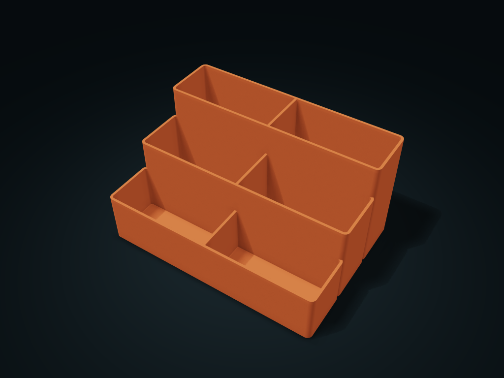

# Stepped Desk Caddy

Keep small items in front and pens or tools in taller rear rows; access from above. Adjust dividers, rows and total height, with linked row heights.

**[Preview this model and customize it on boxesmodel](https://boxesmodel.com/models/stepped-caddy)**

## Default model

| Property | Value |
| --- | --- |
| Category | Desktop Organizers |
| Model version | 1.0.0 |
| Default box size | 210 × 150 × 110 mm |
| Included parts | 1 |
| Formats | STL and STEP |
| Units | Millimeters |

Dimensions include the outer outline of the box; see the specifications for usable interior space.

## Intended use

- Small items, pens and tools; choose row space for their actual shapes.

## Dimensions and features

| Detail | Default value |
| --- | --- |
| Straight-side clear depth per row | 46.8 mm |
| Front / rear row clear height | 47.1 / 107.6 mm |

## Download the parts

Open a file below and choose **Download raw file** on GitHub. STL is for slicers; STEP is for CAD editing.

| Part | Dimensions | STL | STEP |
| --- | --- | --- | --- |
| Stepped storage box | 210 × 150 × 110 mm | [caddy.stl](caddy.stl) | [caddy.step](caddy.step) |

Each listed part has its own STL and STEP file. Preview colors are illustrative; the manufacturing files do not contain the displayed colors.

## Printing and assembly

- One-piece, placed base down. Front and rear zone heights follow the total height and number of rows.
- Import at millimeter scale. Check your build volume, orientation, overhangs, supports and mating clearances in the slicer.

## Adjust the design

Visit the [interactive model page](https://boxesmodel.com/models/stepped-caddy) to inspect the 3D model and adjust the available dimensions and layout options. This folder contains the default-size export shown above; custom exports follow the options and pricing shown on boxesmodel.

## License and attribution

Copyright © 2026 boxesmodel. These model files, preview and description are licensed under [CC BY 4.0](https://creativecommons.org/licenses/by/4.0/). You may share, modify and use them commercially with the required attribution. See the [full license](../../LICENSE) and [attribution guide](../../ATTRIBUTION.md).

Suggested credit:

> “Stepped Desk Caddy” by [boxesmodel](https://boxesmodel.com/models/stepped-caddy), licensed under [CC BY 4.0](https://creativecommons.org/licenses/by/4.0/). Indicate any changes you make.

[Browse all models](../../CATALOG.md) · [About the collection](../../README.md)
