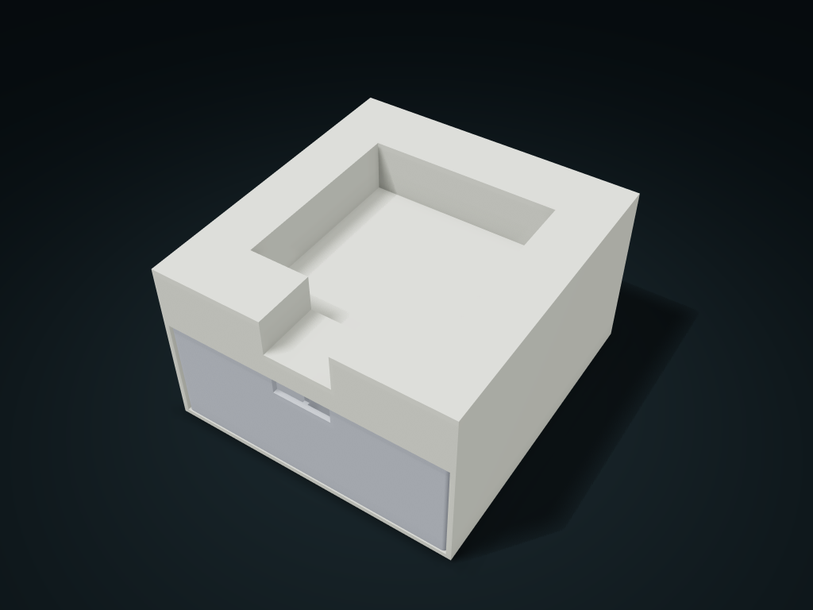

# Sticky Note Holder with Mini Drawer

Keep sticky notes above, lifting sheets at the front recess, and small items in the drawer; size for paper packs, stack height and drawer dividers.

**[Preview this model and customize it on boxesmodel](https://boxesmodel.com/models/sticky-note-drawer)**

## Default model

| Property | Value |
| --- | --- |
| Category | Drawer Storage |
| Model version | 1.0.1 |
| Default assembly display size | 140 × 150 × 85 mm |
| Included parts | 2 |
| Formats | STL and STEP |
| Units | Millimeters |

Covers the layout of all parts in the current preview; see Files and dimensions for each part's print size.

## Intended use

- Sticky note packs and small items; the drawer has no retention lock. Check cabinet bridging and sliding with a test print.

## Dimensions and features

| Detail | Default value |
| --- | --- |
| Sticky note compartment clear size | 90.0 × 90.0 × 25.0 mm |
| Drawer clear height | 49.6 mm |

## Download the parts

Open a file below and choose **Download raw file** on GitHub. STL is for slicers; STEP is for CAD editing.

| Part | Dimensions | STL | STEP |
| --- | --- | --- | --- |
| Sticky note holder cabinet | 140 × 150 × 85 mm | [cabinet.stl](cabinet.stl) | [cabinet.step](cabinet.step) |
| Stationery column drawer | 134.4 × 146.8 × 52 mm | [drawer.stl](drawer.stl) | [drawer.step](drawer.step) |

Each listed part has its own STL and STEP file. Preview colors are illustrative; the manufacturing files do not contain the displayed colors.

## Printing and assembly

- The upper level is sized by the measured net length, width and stack height of the paper packs, with a front notch to lift sheets with a finger; a separate lower drawer holds small items.
- 0.4 mm single-side pull clearance, supported underneath and stopped by the back plate; no anti-separation lock. Test-print to check cabinet bridging and real drawer pulling first.
- Import at millimeter scale. Check your build volume, orientation, overhangs, supports and mating clearances in the slicer.

## Adjust the design

Visit the [interactive model page](https://boxesmodel.com/models/sticky-note-drawer) to inspect the 3D model and adjust the available dimensions and layout options. This folder contains the default-size export shown above; custom exports follow the options and pricing shown on boxesmodel.

## License and attribution

Copyright © 2026 boxesmodel. These model files, preview and description are licensed under [CC BY 4.0](https://creativecommons.org/licenses/by/4.0/). You may share, modify and use them commercially with the required attribution. See the [full license](../../LICENSE) and [attribution guide](../../ATTRIBUTION.md).

Suggested credit:

> “Sticky Note Holder with Mini Drawer” by [boxesmodel](https://boxesmodel.com/models/sticky-note-drawer), licensed under [CC BY 4.0](https://creativecommons.org/licenses/by/4.0/). Indicate any changes you make.

[Browse all models](../../CATALOG.md) · [About the collection](../../README.md)
