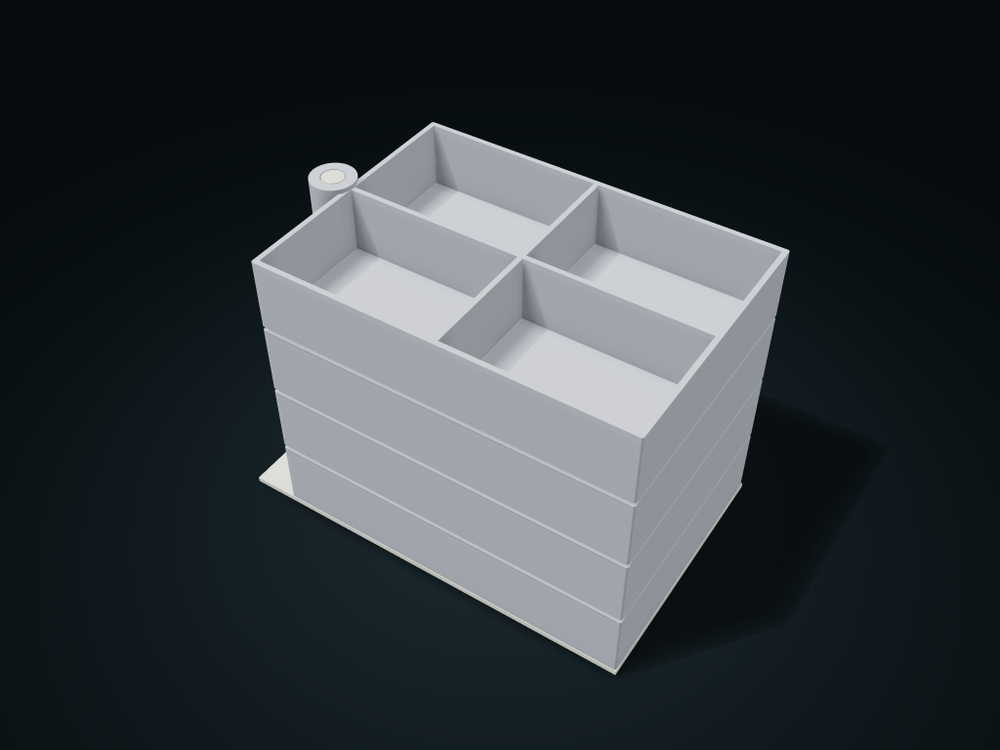

# Swivel Tiered Storage Trays

Each level swings out around the vertical axle, with the axle shoulders supporting neighboring trays.

**[Preview this model and customize it on boxesmodel](https://boxesmodel.com/models/swivel-tray-tower)**

## Default model

| Property | Value |
| --- | --- |
| Category | Stackable Storage |
| Model version | 1.0.1 |
| Default assembly display size | 190 × 120 × 140 mm |
| Included parts | 5 |
| Formats | STL and STEP |
| Units | Millimeters |

Covers the layout of all parts in the current preview; see Files and dimensions for each part's print size.

## Dimensions and features

| Detail | Default value |
| --- | --- |
| Clear height per level | 30.0 mm |
| Compartments per level | 4 |

## Download the parts

Open a file below and choose **Download raw file** on GitHub. STL is for slicers; STEP is for CAD editing.

| Part | Dimensions | STL | STEP |
| --- | --- | --- | --- |
| Base and locating axle | 190 × 120 × 140 mm | [base.stl](base.stl) | [base.step](base.step) |
| Rotating compartment tray 1 | 187.2 × 119.2 × 34.4 mm | [tray-1.stl](tray-1.stl) | [tray-1.step](tray-1.step) |
| Rotating compartment tray 2 | 187.2 × 119.2 × 34.4 mm | [tray-2.stl](tray-2.stl) | [tray-2.step](tray-2.step) |
| Rotating compartment tray 3 | 187.2 × 119.2 × 34.4 mm | [tray-3.stl](tray-3.stl) | [tray-3.step](tray-3.step) |
| Rotating compartment tray 4 | 187.2 × 119.2 × 34.4 mm | [tray-4.stl](tray-4.stl) | [tray-4.step](tray-4.step) |

Each listed part has its own STL and STEP file. Preview colors are illustrative; the manufacturing files do not contain the displayed colors.

## Printing and assembly

- Each tray slides down over the vertical axle from the top, and the ring shoulders support the level above; swing out around the same vertical axis to take items, and take them off level by level from the top.
- Each level has the same cells; number of levels and axle diameter are adjustable; 2 mm between tray rims; leave desk space for the trays to swing out from the base.
- No top lock; support the base when moving; test-print to check full-load tip resistance, rotation friction and load-bearing first.
- Import at millimeter scale. Check your build volume, orientation, overhangs, supports and mating clearances in the slicer.

## Adjust the design

Visit the [interactive model page](https://boxesmodel.com/models/swivel-tray-tower) to inspect the 3D model and adjust the available dimensions and layout options. This folder contains the default-size export shown above; custom exports follow the options and pricing shown on boxesmodel.

## License and attribution

Copyright © 2026 boxesmodel. These model files, preview and description are licensed under [CC BY 4.0](https://creativecommons.org/licenses/by/4.0/). You may share, modify and use them commercially with the required attribution. See the [full license](../../LICENSE) and [attribution guide](../../ATTRIBUTION.md).

Suggested credit:

> “Swivel Tiered Storage Trays” by [boxesmodel](https://boxesmodel.com/models/swivel-tray-tower), licensed under [CC BY 4.0](https://creativecommons.org/licenses/by/4.0/). Indicate any changes you make.

[Browse all models](../../CATALOG.md) · [About the collection](../../README.md)
