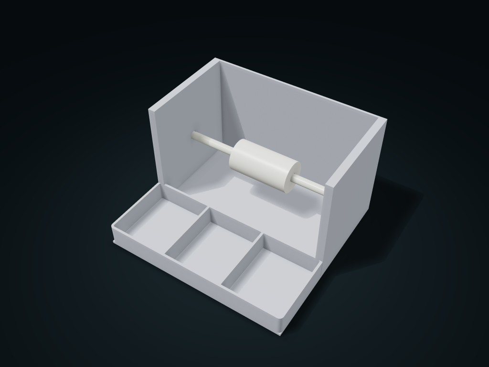

# Tape Roll Tool Organizer

A whole roll of tape is supported by a separate core sleeve and side-pull reel, with front columns for scissors and small tools.

**[Preview this model and customize it on boxesmodel](https://boxesmodel.com/models/tape-tool-box)**

## Default model

| Property | Value |
| --- | --- |
| Category | Desktop Organizers |
| Model version | 1.0.0 |
| Default assembly display size | 180 × 170 × 110 mm |
| Included parts | 3 |
| Formats | STL and STEP |
| Units | Millimeters |

Covers the layout of all parts in the current preview; see Files and dimensions for each part's print size.

## Dimensions and features

| Detail | Default value |
| --- | --- |
| Full roll fit | 60 × Ø90 mm |
| Roll core inner diameter | Ø32 mm |
| Front tray columns | 3 |
| Front tray clear depth | 66.8 mm |

## Download the parts

Open a file below and choose **Download raw file** on GitHub. STL is for slicers; STEP is for CAD editing.

| Part | Dimensions | STL | STEP |
| --- | --- | --- | --- |
| Roll strap seat and front column tray | 180 × 170 × 110 mm | [body.stl](body.stl) | [body.step](body.step) |
| Side-pull headed reel | 177.2 × 12 × 12 mm | [axle.stl](axle.stl) | [axle.step](axle.step) |
| Reel core adapter sleeve | 59.6 × 31.2 × 31.2 mm | [sleeve.stl](sleeve.stl) | [sleeve.step](sleeve.step) |

Each listed part has its own STL and STEP file. Preview colors are illustrative; the manufacturing files do not contain the displayed colors.

## Printing and assembly

- Pass the core sleeve through the actual roll core, drop it into the rear compartment from above, then insert the reel from the left; to change rolls, pull the axle out to the left, then lift the whole roll.
- Leave one box length of space on the left to pull the axle; measure roll width, outer diameter and core diameter from the real item; the core sleeve keeps a fixed assembly allowance.
- Pull the tape out forward and up, and cut it with separate scissors; no blades or automatic dispensing mechanism.
- Adjust orientation and supports for the round axle and sleeve when printing; test-print to check turning fit and pulling stability first.
- Import at millimeter scale. Check your build volume, orientation, overhangs, supports and mating clearances in the slicer.

## Adjust the design

Visit the [interactive model page](https://boxesmodel.com/models/tape-tool-box) to inspect the 3D model and adjust the available dimensions and layout options. This folder contains the default-size export shown above; custom exports follow the options and pricing shown on boxesmodel.

## License and attribution

Copyright © 2026 boxesmodel. These model files, preview and description are licensed under [CC BY 4.0](https://creativecommons.org/licenses/by/4.0/). You may share, modify and use them commercially with the required attribution. See the [full license](../../LICENSE) and [attribution guide](../../ATTRIBUTION.md).

Suggested credit:

> “Tape Roll Tool Organizer” by [boxesmodel](https://boxesmodel.com/models/tape-tool-box), licensed under [CC BY 4.0](https://creativecommons.org/licenses/by/4.0/). Indicate any changes you make.

[Browse all models](../../CATALOG.md) · [About the collection](../../README.md)
