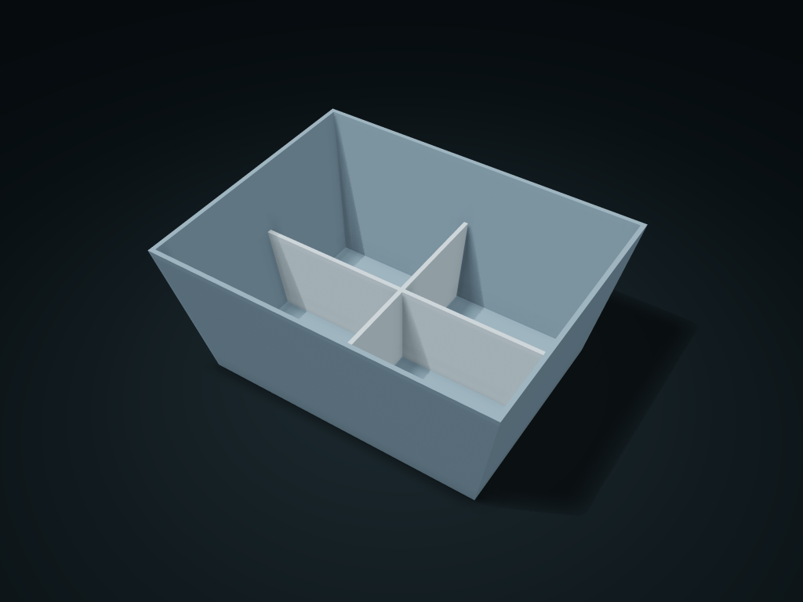

# Tapered-Wall Nesting Sorting Box

An upward-flared box with a lift-out cross divider insert; with the insert removed, identical empty boxes nest

**[Preview this model and customize it on boxesmodel](https://boxesmodel.com/models/taper-nesting-bin)**

## Default model

| Property | Value |
| --- | --- |
| Category | Desktop Organizers |
| Model version | 1.0.0 |
| Default assembly display size | 180 × 140 × 80 mm |
| Included parts | 2 |
| Formats | STL and STEP |
| Units | Millimeters |

Covers the layout of all parts in the current preview; see Files and dimensions for each part's print size.

## Dimensions and features

| Detail | Default value |
| --- | --- |
| Verified stacking height of empty boxes | 15.8 mm |
| Cross insert edge clearance | 0.5 mm |

## Download the parts

Open a file below and choose **Download raw file** on GitHub. STL is for slicers; STEP is for CAD editing.

| Part | Dimensions | STL | STEP |
| --- | --- | --- | --- |
| Flared nesting box | 180 × 140 × 80 mm | [body.stl](body.stl) | [body.step](body.step) |
| Lift-out cross insert | 161.98 × 121.98 × 45 mm | [cross.stl](cross.stl) | [cross.step](cross.step) |

Each listed part has its own STL and STEP file. Preview colors are illustrative; the manufacturing files do not contain the displayed colors.

## Printing and assembly

- Print both parts flat on their bases; the cross insert drops straight onto the box floor from above, with no latch. Only after the insert is removed can it nest with an empty box of the same parameters.
- The theoretical minimum stacking height of identical empty boxes is about wall thickness × box height ÷ flare difference; leave extra so they do not jam; check the nesting fit of empty boxes before stacking.
- Import at millimeter scale. Check your build volume, orientation, overhangs, supports and mating clearances in the slicer.

## Adjust the design

Visit the [interactive model page](https://boxesmodel.com/models/taper-nesting-bin) to inspect the 3D model and adjust the available dimensions and layout options. This folder contains the default-size export shown above; custom exports follow the options and pricing shown on boxesmodel.

## License and attribution

Copyright © 2026 boxesmodel. These model files, preview and description are licensed under [CC BY 4.0](https://creativecommons.org/licenses/by/4.0/). You may share, modify and use them commercially with the required attribution. See the [full license](../../LICENSE) and [attribution guide](../../ATTRIBUTION.md).

Suggested credit:

> “Tapered-Wall Nesting Sorting Box” by [boxesmodel](https://boxesmodel.com/models/taper-nesting-bin), licensed under [CC BY 4.0](https://creativecommons.org/licenses/by/4.0/). Indicate any changes you make.

[Browse all models](../../CATALOG.md) · [About the collection](../../README.md)
