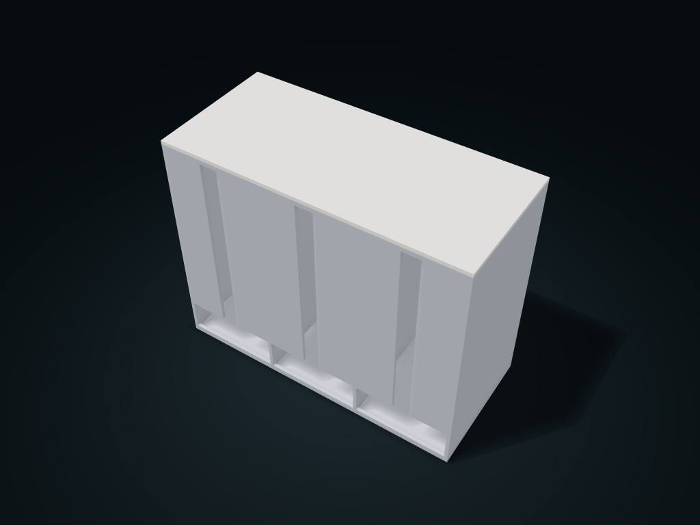

# Side-Pull Tea Bag Box

Sort wrapped tea bags by compartment, refill at the top and pull from bottom windows; adjust box size, compartments and outlet height.

**[Preview this model and customize it on boxesmodel](https://boxesmodel.com/models/tea-sachet-tower)**

## Default model

| Property | Value |
| --- | --- |
| Category | Lidded Storage |
| Model version | 1.0.1 |
| Default assembly display size | 200 × 90 × 160 mm |
| Included parts | 2 |
| Formats | STL and STEP |
| Units | Millimeters |

Covers the layout of all parts in the current preview; see Files and dimensions for each part's print size.

## Intended use

- Individually wrapped tea bags; viewing slots must be narrower than the bags. No automatic single-bag separation. The lid does not seal; check retrieval and window bridging with a test print.

## Dimensions and features

| Detail | Default value |
| --- | --- |
| Clear width per compartment | 63.5 mm |
| Clear depth per compartment | 85.2 mm |

## Download the parts

Open a file below and choose **Download raw file** on GitHub. STL is for slicers; STEP is for CAD editing.

| Part | Dimensions | STL | STEP |
| --- | --- | --- | --- |
| Multi-compartment tea bag box | 200 × 90 × 157.6 mm | [body.stl](body.stl) | [body.step](body.step) |
| Top refill locating lid | 200 × 90 × 5.4 mm | [lid.stl](lid.stl) | [lid.step](lid.step) |

Each listed part has its own STL and STEP file. Preview colors are illustrative; the manufacturing files do not contain the displayed colors.

## Printing and assembly

- Individually wrapped tea bags are refilled from the top and pulled out by hand through the bottom window; automatic one-bag-at-a-time dispensing is not guaranteed.
- Measure compartment width and depth from the actual outer packaging; the viewing slit must be narrower than the bag; a 2 mm lip at the bottom stops the whole stack sliding straight out.
- Located lift-off lid, 0.4 mm single-side clearance; no seal. Test-print first to check side window bridging and how bags come out of real soft packaging.
- Import at millimeter scale. Check your build volume, orientation, overhangs, supports and mating clearances in the slicer.

## Adjust the design

Visit the [interactive model page](https://boxesmodel.com/models/tea-sachet-tower) to inspect the 3D model and adjust the available dimensions and layout options. This folder contains the default-size export shown above; custom exports follow the options and pricing shown on boxesmodel.

## License and attribution

Copyright © 2026 boxesmodel. These model files, preview and description are licensed under [CC BY 4.0](https://creativecommons.org/licenses/by/4.0/). You may share, modify and use them commercially with the required attribution. See the [full license](../../LICENSE) and [attribution guide](../../ATTRIBUTION.md).

Suggested credit:

> “Side-Pull Tea Bag Box” by [boxesmodel](https://boxesmodel.com/models/tea-sachet-tower), licensed under [CC BY 4.0](https://creativecommons.org/licenses/by/4.0/). Indicate any changes you make.

[Browse all models](../../CATALOG.md) · [About the collection](../../README.md)
