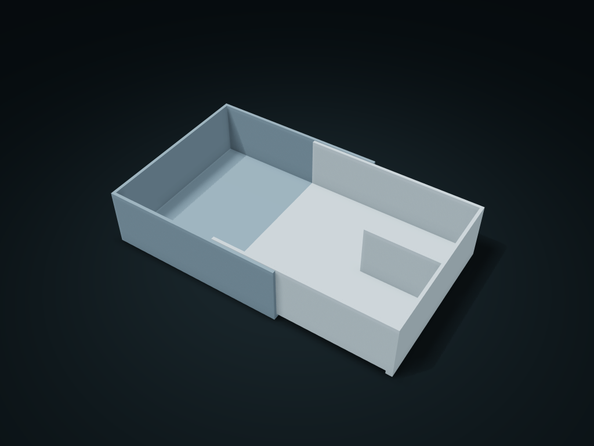

# Overlapping Telescopic Storage Tray

Two offset open tray sections overlap along the side walls to fit the drawer length

**[Preview this model and customize it on boxesmodel](https://boxesmodel.com/models/telescoping-overlap-tray)**

## Default model

| Property | Value |
| --- | --- |
| Category | Desktop Organizers |
| Model version | 1.0.0 |
| Default assembly display size | 220 × 130 × 45 mm |
| Included parts | 2 |
| Formats | STL and STEP |
| Units | Millimeters |

Covers the layout of all parts in the current preview; see Files and dimensions for each part's print size.

## Dimensions and features

| Detail | Default value |
| --- | --- |
| Actual length per section | 135 mm |
| Inner section divided zone | 55 mm |

## Download the parts

Open a file below and choose **Download raw file** on GitHub. STL is for slicers; STEP is for CAD editing.

| Part | Dimensions | STL | STEP |
| --- | --- | --- | --- |
| Outer half tray | 135 × 130 × 45 mm | [outer.stl](outer.stl) | [outer.step](outer.step) |
| Overlapping inner tray | 135 × 124.2 × 45 mm | [inner.stl](inner.stl) | [inner.step](inner.step) |

Each listed part has its own STL and STEP file. Preview colors are illustrative; the manufacturing files do not contain the displayed colors.

## Printing and assembly

- Print both parts flat on their bases; the inner section slides into the outer section from the open right end, with 0.5 mm clearance per side and at the bottom. The inner section's underside forms a step of one wall thickness plus clearance; the short inner-end feet rest on the outer section's floor, and the far-end feet rest on the drawer bottom.
- The overlap controls the joined length when generated; no latch; do not pick it up as a carry case. The drawer must support both sections; remove items before taking it out to clean.
- Import at millimeter scale. Check your build volume, orientation, overhangs, supports and mating clearances in the slicer.

## Adjust the design

Visit the [interactive model page](https://boxesmodel.com/models/telescoping-overlap-tray) to inspect the 3D model and adjust the available dimensions and layout options. This folder contains the default-size export shown above; custom exports follow the options and pricing shown on boxesmodel.

## License and attribution

Copyright © 2026 boxesmodel. These model files, preview and description are licensed under [CC BY 4.0](https://creativecommons.org/licenses/by/4.0/). You may share, modify and use them commercially with the required attribution. See the [full license](../../LICENSE) and [attribution guide](../../ATTRIBUTION.md).

Suggested credit:

> “Overlapping Telescopic Storage Tray” by [boxesmodel](https://boxesmodel.com/models/telescoping-overlap-tray), licensed under [CC BY 4.0](https://creativecommons.org/licenses/by/4.0/). Indicate any changes you make.

[Browse all models](../../CATALOG.md) · [About the collection](../../README.md)
