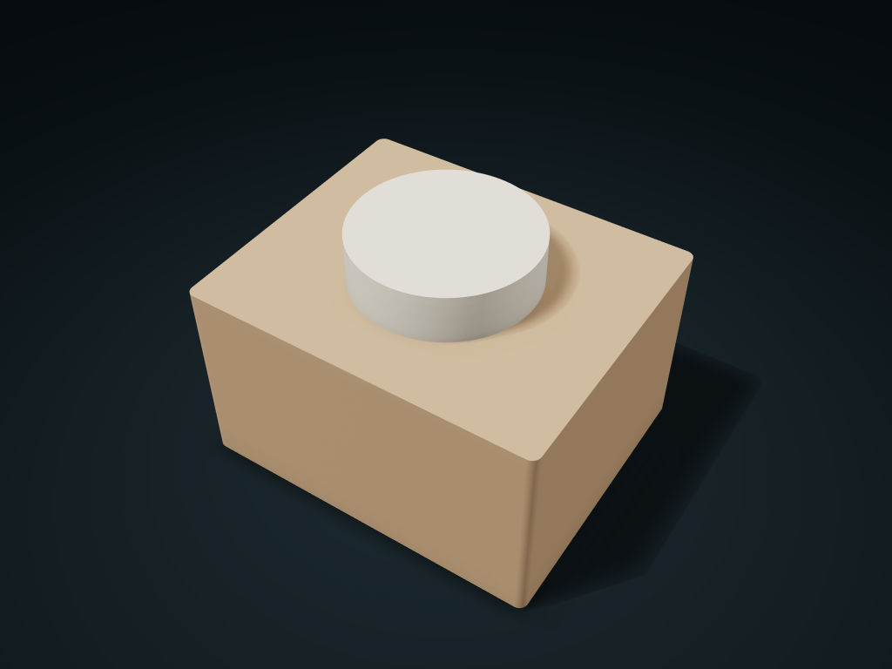

# Screw-Lid Refill Box

A square body storage space with a round opening and a real threaded lid for repeated refilling.

**[Preview this model and customize it on boxesmodel](https://boxesmodel.com/models/threaded-port-box)**

## Default model

| Property | Value |
| --- | --- |
| Category | Lidded Storage |
| Model version | 1.0.0 |
| Default assembly display size | 120 × 100 × 85 mm |
| Included parts | 2 |
| Formats | STL and STEP |
| Units | Millimeters |

Covers the layout of all parts in the current preview; see Files and dimensions for each part's print size.

## Dimensions and features

| Detail | Default value |
| --- | --- |
| Round opening clear diameter | 48.0 mm |
| Pitch / turns | 4.0 mm / 2 |
| Main body storage clear height | 63.4 mm |

## Download the parts

Open a file below and choose **Download raw file** on GitHub. STL is for slicers; STEP is for CAD editing.

| Part | Dimensions | STL | STEP |
| --- | --- | --- | --- |
| Square body round mouth storage box | 120 × 100 × 82.2 mm | [body.stl](body.stl) | [body.step](body.step) |
| Matching threaded screw lid | 60.7 × 60.7 × 16.8 mm | [cap.stl](cap.stl) | [cap.step](cap.step) |

Each listed part has its own STL and STEP file. Preview colors are illustrative; the manufacturing files do not contain the displayed colors.

## Printing and assembly

- Load and pour small items through the round opening; the inside stays connected, with no compartments blocking pouring; diameters are clear openings.
- Single-start right-hand thread: turning counterclockwise also moves it up, rising one pitch per turn; the bottom end face rests on the shoulder.
- Test-print the fixed 0.35 mm thread clearance first; not for airtightness, watertightness or food safety; check the screw-in fit after a P1S/PLA test print.
- Slicing the lid top down reduces internal overhangs; the inner top at the square box shoulders may need supports.
- Import at millimeter scale. Check your build volume, orientation, overhangs, supports and mating clearances in the slicer.

## Adjust the design

Visit the [interactive model page](https://boxesmodel.com/models/threaded-port-box) to inspect the 3D model and adjust the available dimensions and layout options. This folder contains the default-size export shown above; custom exports follow the options and pricing shown on boxesmodel.

## License and attribution

Copyright © 2026 boxesmodel. These model files, preview and description are licensed under [CC BY 4.0](https://creativecommons.org/licenses/by/4.0/). You may share, modify and use them commercially with the required attribution. See the [full license](../../LICENSE) and [attribution guide](../../ATTRIBUTION.md).

Suggested credit:

> “Screw-Lid Refill Box” by [boxesmodel](https://boxesmodel.com/models/threaded-port-box), licensed under [CC BY 4.0](https://creativecommons.org/licenses/by/4.0/). Indicate any changes you make.

[Browse all models](../../CATALOG.md) · [About the collection](../../README.md)
