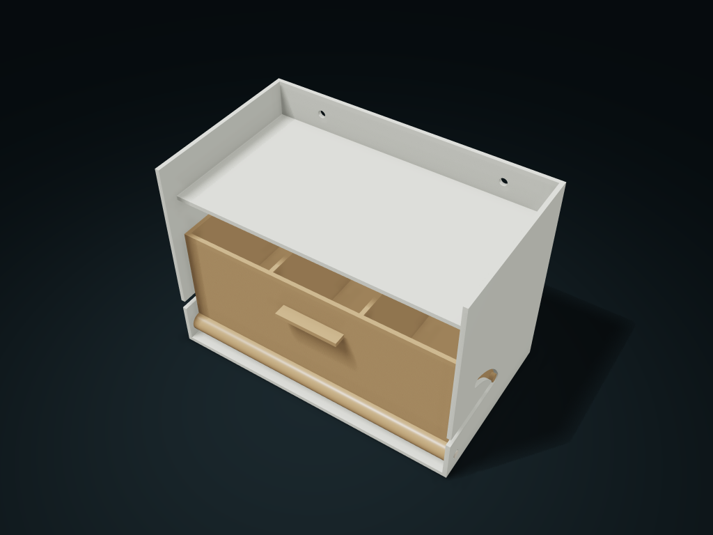

# Arc-Slot Tip-Out Bin

The column compartment tips forward around a bottom cross axle, its travel limited by arc slots; pull the axle to remove the whole compartment.

**[Preview this model and customize it on boxesmodel](https://boxesmodel.com/models/tilt-sector-bin)**

## Default model

| Property | Value |
| --- | --- |
| Category | Drawer Storage |
| Model version | 1.0.1 |
| Default assembly display size | 168.8 × 96.4 × 119.4 mm |
| Included parts | 3 |
| Formats | STL and STEP |
| Units | Millimeters |

Covers the layout of all parts in the current preview; see Files and dimensions for each part's print size.

## Dimensions and features

| Detail | Default value |
| --- | --- |
| Separate columns | 3 columns |
| Clear width per column | 50.1 mm |
| Front stop height | 63.8 mm |
| Top pick-up opening clear depth | 50.1 mm |
| Maximum forward tilt angle | 45° |

## Download the parts

Open a file below and choose **Download raw file** on GitHub. STL is for slicers; STEP is for CAD editing.

| Part | Dimensions | STL | STEP |
| --- | --- | --- | --- |
| Arc slot fixed frame | 165.6 × 96.4 × 119.4 mm | [cabinet.stl](cabinet.stl) | [cabinet.step](cabinet.step) |
| Tip-forward column compartment | 164.6 × 92 × 69.25 mm | [bucket.stl](bucket.stl) | [bucket.step](bucket.step) |
| Headed pull-out cross axle | 168.8 × 8.4 × 8.4 mm | [axle.stl](axle.stl) | [axle.step](axle.step) |

Each listed part has its own STL and STEP file. Preview colors are illustrative; the manufacturing files do not contain the displayed colors.

## Printing and assembly

- The compartment slides in horizontally from the front, and the guide pins on both sides enter the start of the arc slots; align the bottom holes, then insert the cross axle from the left.
- First fix the frame to a vertical support with two M4 screws, then fit the compartment; choose screw length and anchors by the substrate and supply them yourself.
- The column count changes the actual inner cavity; the front stop height ratio affects volume and the access opening; the maximum tilt angle also changes the arc slot stops.
- Tip forward to the end of the arc slot to take items; with it closed and the cross axle pulled out, the whole compartment slides out from the front for cleaning. Leave full axle-pulling space on the left.
- The cross axle has no tail lock; check that it has not backed out before moving; no closing latch or seal. Do not tip the frame forward fully loaded before it is fixed.
- Print the cabinet frame back and the compartment side flat on the plate; check supports for the horizontal cross axle; before use, check the rotating fit, pin retention and load-bearing.
- Import at millimeter scale. Check your build volume, orientation, overhangs, supports and mating clearances in the slicer.

## Adjust the design

Visit the [interactive model page](https://boxesmodel.com/models/tilt-sector-bin) to inspect the 3D model and adjust the available dimensions and layout options. This folder contains the default-size export shown above; custom exports follow the options and pricing shown on boxesmodel.

## License and attribution

Copyright © 2026 boxesmodel. These model files, preview and description are licensed under [CC BY 4.0](https://creativecommons.org/licenses/by/4.0/). You may share, modify and use them commercially with the required attribution. See the [full license](../../LICENSE) and [attribution guide](../../ATTRIBUTION.md).

Suggested credit:

> “Arc-Slot Tip-Out Bin” by [boxesmodel](https://boxesmodel.com/models/tilt-sector-bin), licensed under [CC BY 4.0](https://creativecommons.org/licenses/by/4.0/). Indicate any changes you make.

[Browse all models](../../CATALOG.md) · [About the collection](../../README.md)
