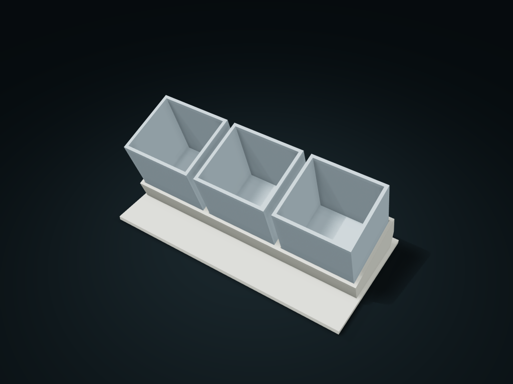

# Forward-Tilt Pull-Out Divider Rack

Wedge supports hold separate closed-bottom inner cups that slide out along an axis angled forward and up, for cleaning cup by cup or moving to the work area.

**[Preview this model and customize it on boxesmodel](https://boxesmodel.com/models/tilted-cartridge-caddy)**

## Default model

| Property | Value |
| --- | --- |
| Category | Desktop Organizers |
| Model version | 1.0.0 |
| Default assembly display size | 220 × 110 × 95 mm |
| Included parts | 4 |
| Formats | STL and STEP |
| Units | Millimeters |

Covers the layout of all parts in the current preview; see Files and dimensions for each part's print size.

## Dimensions and features

| Detail | Default value |
| --- | --- |
| Real overall outer envelope | 220 × 110 × 95 mm |
| Inner cups / columns per cup | 3 cups / 1 column |
| Axial clear width / clear depth / clear height per column | 59.1 / 54.4 / 73.4 mm |
| Extra front/top clearance needed for an empty cup to clear the guide sleeve | 7.4 / 22.8 mm |
| Guide sleeve height / single-side nominal clearance | 22 / 0.6 mm |

## Download the parts

Open a file below and choose **Download raw file** on GitHub. STL is for slicers; STEP is for CAD editing.

| Part | Dimensions | STL | STEP |
| --- | --- | --- | --- |
| Wedge supports and low guide sleeve rack | 220 × 110 × 44.51 mm | [frame.stl](frame.stl) | [frame.step](frame.step) |
| Separate tilted-axis divided cup 1 | 64.67 × 80.61 × 91 mm | [cup-1.stl](cup-1.stl) | [cup-1.step](cup-1.step) |
| Separate tilted-axis divided cup 2 | 64.67 × 80.61 × 91 mm | [cup-2.stl](cup-2.stl) | [cup-2.step](cup-2.step) |
| Separate tilted-axis divided cup 3 | 64.67 × 80.61 × 91 mm | [cup-3.stl](cup-3.stl) | [cup-3.step](cup-3.step) |

Each listed part has its own STL and STEP file. Preview colors are illustrative; the manufacturing files do not contain the displayed colors.

## Printing and assembly

- Cup mouths tilt 18° forward and insert/remove coaxially along an axis angled forward and up; each cup has its own closed bottom resting fully on the wedge deck, and the 22 mm low guide sleeve keeps 0.6 mm geometric clearance per side. No lock; not a moving hinge.
- Empty the target cup first, then pull it out 24 mm axially to clear the guide sleeve; needs an extra 7.4 mm in front and 22.8 mm above. Under a monitor, check clearance including how far items stick up; do not pull straight up by force or lift cups when the space above is packed.
- For dry stationery such as pens, USB drives and short rulers; measure items against the inner column clear size and leave room to take them. Long items must stick out of the cup to be grabbed; for loose small items, lift out the whole empty cup to take them; no brand fit is promised.
- One fixed frame plus separate cups; no hardware or glue needed. Empty/remove each cup before moving the whole rack; the frame has no anti-separation lock; before use, check tip resistance, load-bearing and fit.
- The inner cups are shown at their assembly angle; when slicing, rotate each inner cup's closed bottom onto the bed, with the frame base down. Check overhangs and supports of the tilted guide sleeves when slicing.
- Import at millimeter scale. Check your build volume, orientation, overhangs, supports and mating clearances in the slicer.

## Adjust the design

Visit the [interactive model page](https://boxesmodel.com/models/tilted-cartridge-caddy) to inspect the 3D model and adjust the available dimensions and layout options. This folder contains the default-size export shown above; custom exports follow the options and pricing shown on boxesmodel.

## License and attribution

Copyright © 2026 boxesmodel. These model files, preview and description are licensed under [CC BY 4.0](https://creativecommons.org/licenses/by/4.0/). You may share, modify and use them commercially with the required attribution. See the [full license](../../LICENSE) and [attribution guide](../../ATTRIBUTION.md).

Suggested credit:

> “Forward-Tilt Pull-Out Divider Rack” by [boxesmodel](https://boxesmodel.com/models/tilted-cartridge-caddy), licensed under [CC BY 4.0](https://creativecommons.org/licenses/by/4.0/). Indicate any changes you make.

[Browse all models](../../CATALOG.md) · [About the collection](../../README.md)
