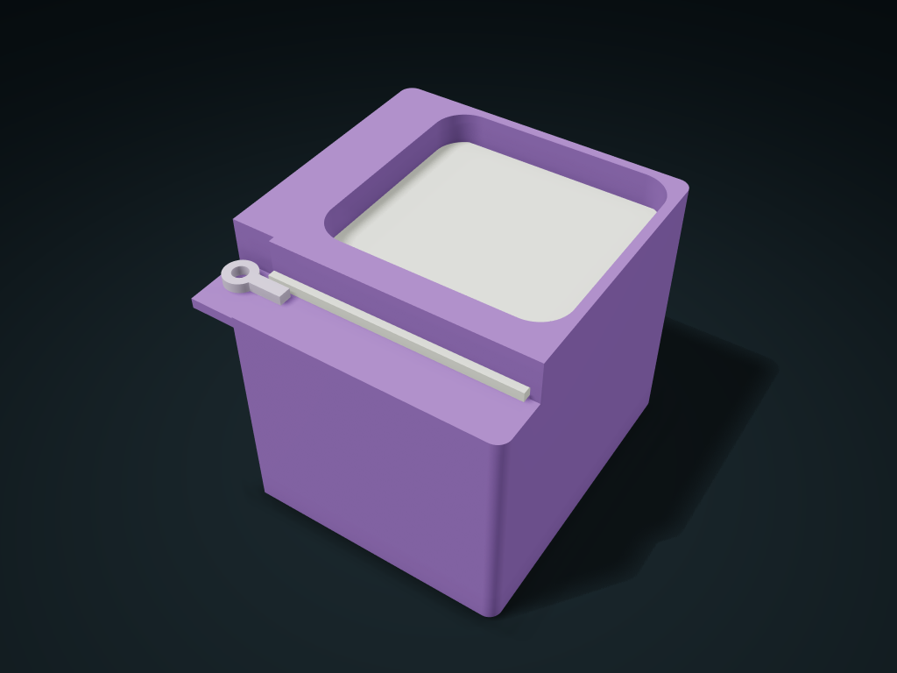

# Sliding Stop Lid Dice Shaker Cup

Store dice and small markers in one cavity; release the bar and slide off the lid to pour. Adjust opening size, inner corners and bar length.

**[Preview this model and customize it on boxesmodel](https://boxesmodel.com/models/turn-bar-dice-cup)**

## Default model

| Property | Value |
| --- | --- |
| Category | Lidded Storage |
| Model version | 1.0.0 |
| Default assembly display size | 95 × 100 × 85 mm |
| Included parts | 3 |
| Formats | STL and STEP |
| Units | Millimeters |

Covers the layout of all parts in the current preview; see Files and dimensions for each part's print size.

## Intended use

- Dice and small markers; hold the lid and bar while shaking. No randomness claim; check retention during use and transport. Leave one cup depth ahead for the lid and another 10 mm for bar movement.
- Supply one fully threaded M4 bolt, two washers with 9 mm outer diameter, 4.3 mm inner diameter and 0.8 mm thickness, and one AF7 mm nut, 3.2 mm high. Printed files contain only cup, lid and bar.
- Choose bolt length from the current size list: default M4×12 mm, or M4×14 mm for a thicker lid. Head diameter ≤7 mm, height ≤4 mm. The bar must rotate; trial-fit the nut retention and joints.

## Dimensions and features

| Detail | Default value |
| --- | --- |
| Cup cavity straight-side clear width × depth | 73 × 70 mm； Corner fillet R10 |
| Clear height under the lid | 69 mm |
| Reference small dice in use | 12 mm envelope as a reference for taking items in and out; leave some empty space; a full load does not show the shaking effect |
| Turning bar effective length / angle | 15 mm / 90° |
| M4 joining nut / remaining screw length | 3.2 mm / 1.0 mm |
| Suggested colors | Violet/lime, sage/warm gray, terracotta/navy, haze blue/cream, berry/light pink, slate/mustard |

## Download the parts

Open a file below and choose **Download raw file** on GitHub. STL is for slicers; STEP is for CAD editing.

| Part | Dimensions | STL | STEP |
| --- | --- | --- | --- |
| Smooth single-cavity cup with an external axle seat | 95 × 100 × 85 mm | [cup.stl](cup.stl) | [cup.step](cup.step) |
| Full-opening captive sliding lid | 77.6 × 81.6 × 3 mm | [shutter.stl](shutter.stl) | [shutter.step](shutter.step) |
| Rotating rigid stop bar | 20 × 10 × 3 mm | [turn-bar.stl](turn-bar.stl) | [turn-bar.step](turn-bar.step) |

Each listed part has its own STL and STEP file. Preview colors are illustrative; the manufacturing files do not contain the displayed colors.

## Printing and assembly

- Supply 1 M4×12 mm fully threaded through bolt (head outer diameter ≤ 7 mm, head height ≤ 4 mm), 2 washers 9 mm outer / 4.3 mm inner / 0.8 mm thick, and 1 nut AF 7 mm / 3.2 mm tall; hardware is not included in the print files.
- The screw passes up through the external short axle seat; fit the seat washer, turning bar, bar washer and nut in order; a 10 mm diameter tool path is left above and below. The lock bar must be able to turn; test nut retention and fit with real parts.
- Seen from above, turn the bar 90° clockwise along the left outside, then push the sliding lid all the way in from the front; then turn it counterclockwise back across; the rigid bar stops the lid moving forward. Release the bar first, then slide the whole lid out flat; the track stops it lifting straight out.
- With the lid removed, drop dice in from the top and pour them out by holding the cup; the cup has no dividers inside; check against the maximum envelope of your actual dice. Hold the lid and stop bar when shaking; random shaking results are not guaranteed; check anti-loosening retention and transport reliability before use.
- Cup/lid/bar each base down; check rail top edge bridging and the external seat when slicing; test-print and test-fit the single-side clearance first.
- The outer size is the closed envelope of the printed parts; the recommended hardware heads, washers, nuts and chosen screw lengths all fit within this envelope. Leave one cup depth in front for opening the lid, plus another 10 mm in front for the turning bar's swing.
- Import at millimeter scale. Check your build volume, orientation, overhangs, supports and mating clearances in the slicer.

### Additional hardware

Supply separately 1 fully threaded M4 through bolt, 2 washers (9 mm OD / 4.3 mm ID / 0.8 mm thick) and 1 nut (AF 7 mm / 3.2 mm high); choose screw length from the current size list (default M4×12 mm, M4×14 mm for a thicker lid), bolt head outer diameter no more than 7 mm, Head height no more than 4 mm. The print files contain only the cup body, sliding lid and turning bar.

## Adjust the design

Visit the [interactive model page](https://boxesmodel.com/models/turn-bar-dice-cup) to inspect the 3D model and adjust the available dimensions and layout options. This folder contains the default-size export shown above; custom exports follow the options and pricing shown on boxesmodel.

## License and attribution

Copyright © 2026 boxesmodel. These model files, preview and description are licensed under [CC BY 4.0](https://creativecommons.org/licenses/by/4.0/). You may share, modify and use them commercially with the required attribution. See the [full license](../../LICENSE) and [attribution guide](../../ATTRIBUTION.md).

Suggested credit:

> “Sliding Stop Lid Dice Shaker Cup” by [boxesmodel](https://boxesmodel.com/models/turn-bar-dice-cup), licensed under [CC BY 4.0](https://creativecommons.org/licenses/by/4.0/). Indicate any changes you make.

[Browse all models](../../CATALOG.md) · [About the collection](../../README.md)
