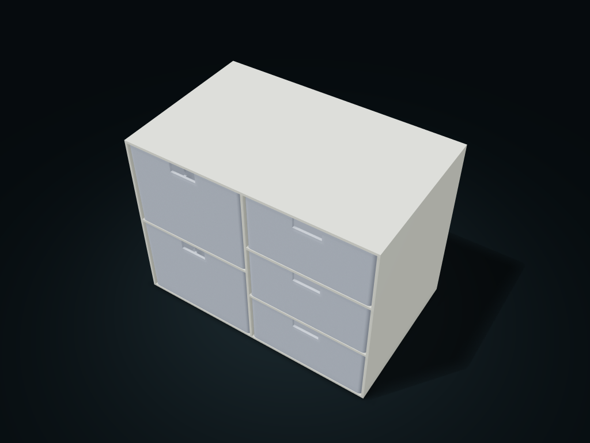

# Two-Column Drawer Cabinet

Left and right width, drawer count and columns are set separately, and the cabinet is generated with the drawers.

**[Preview this model and customize it on boxesmodel](https://boxesmodel.com/models/twin-drawer-cabinet)**

## Default model

| Property | Value |
| --- | --- |
| Category | Drawer Storage |
| Model version | 1.0.0 |
| Default assembly display size | 240 × 150 × 180 mm |
| Included parts | 6 |
| Formats | STL and STEP |
| Units | Millimeters |

Covers the layout of all parts in the current preview; see Files and dimensions for each part's print size.

## Dimensions and features

| Detail | Default value |
| --- | --- |
| Clear height per left column drawer | 83.2 mm |
| Clear height per right column drawer | 53.6 mm |

## Download the parts

Open a file below and choose **Download raw file** on GitHub. STL is for slicers; STEP is for CAD editing.

| Part | Dimensions | STL | STEP |
| --- | --- | --- | --- |
| Two-column cabinet | 240 × 150 × 180 mm | [cabinet.stl](cabinet.stl) | [cabinet.step](cabinet.step) |
| Left column drawer 1 | 115.6 × 146.8 × 85.6 mm | [left-1.stl](left-1.stl) | [left-1.step](left-1.step) |
| Left column drawer 2 | 115.6 × 146.8 × 85.6 mm | [left-2.stl](left-2.stl) | [left-2.step](left-2.step) |
| Right column drawer 1 | 115.6 × 146.8 × 56 mm | [right-1.stl](right-1.stl) | [right-1.step](right-1.step) |
| Right column drawer 2 | 115.6 × 146.8 × 56 mm | [right-2.stl](right-2.stl) | [right-2.step](right-2.step) |
| Right column drawer 3 | 115.6 × 146.8 × 56 mm | [right-3.stl](right-3.stl) | [right-3.step](right-3.step) |

Each listed part has its own STL and STEP file. Preview colors are illustrative; the manufacturing files do not contain the displayed colors.

## Printing and assembly

- Width share, number of drawers and columns are set separately for the left and right columns; drawers in the same column share a layout; do not mix left and right sizes.
- 0.4 mm single-side design clearance, stopped at the back, and pulls fully out at the front; this version has no anti-separation lock.
- The cabinet's horizontal frame needs orientation and supports checked when slicing; drawer bottom down. Test-print to check real sliding and load-bearing first.
- Import at millimeter scale. Check your build volume, orientation, overhangs, supports and mating clearances in the slicer.

## Adjust the design

Visit the [interactive model page](https://boxesmodel.com/models/twin-drawer-cabinet) to inspect the 3D model and adjust the available dimensions and layout options. This folder contains the default-size export shown above; custom exports follow the options and pricing shown on boxesmodel.

## License and attribution

Copyright © 2026 boxesmodel. These model files, preview and description are licensed under [CC BY 4.0](https://creativecommons.org/licenses/by/4.0/). You may share, modify and use them commercially with the required attribution. See the [full license](../../LICENSE) and [attribution guide](../../ATTRIBUTION.md).

Suggested credit:

> “Two-Column Drawer Cabinet” by [boxesmodel](https://boxesmodel.com/models/twin-drawer-cabinet), licensed under [CC BY 4.0](https://creativecommons.org/licenses/by/4.0/). Indicate any changes you make.

[Browse all models](../../CATALOG.md) · [About the collection](../../README.md)
