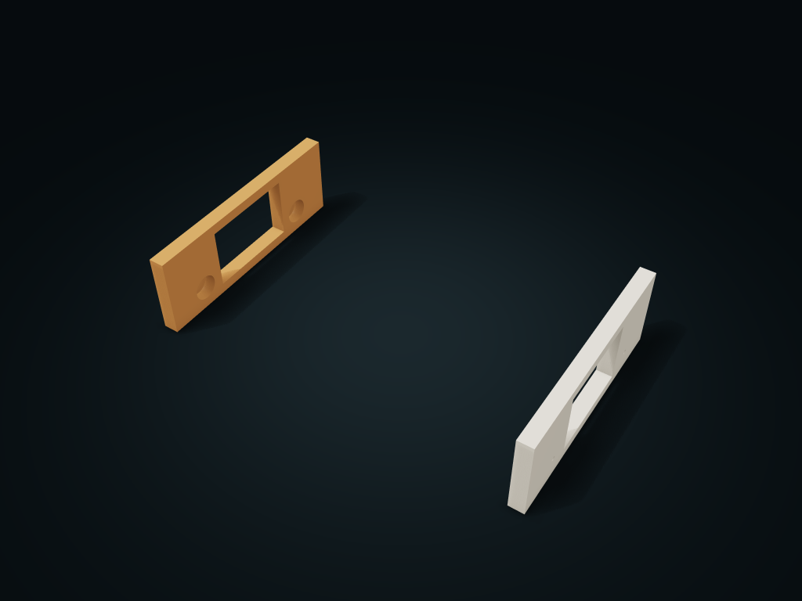

# Twin-Rod Spool Rack

Two blind-hole end frames with separate wooden dowels; position the two rods by spool diameter and height so spools stand upright in a row.

**[Preview this model and customize it on boxesmodel](https://boxesmodel.com/models/twin-rod-spool-cradle)**

## Default model

| Property | Value |
| --- | --- |
| Category | Open Storage |
| Model version | 1.0.0 |
| Default assembly display size | 300 × 180 × 65 mm |
| Included parts | 2 |
| Formats | STL and STEP |
| Units | Millimeters |

Covers the layout of all parts in the current preview; see Files and dimensions for each part's print size.

## Dimensions and features

| Detail | Default value |
| --- | --- |
| Total outer envelope of the printed rack | 300 × 180 × 65 mm |
| Wooden rods supplied separately | 2 × Ø19 × 294 mm |
| Rod center span / center height above the floor | 110 / 17.31 mm |
| Nominal spool diameter / spool bottom above the floor | 200 / 12 mm |
| Clear row width inside the end frames | 276 mm |
| Screw / effective depth into wood | 4 × Ø3 × 20 mm / 17 mm |

## Download the parts

Open a file below and choose **Download raw file** on GitHub. STL is for slicers; STEP is for CAD editing.

| Part | Dimensions | STL | STEP |
| --- | --- | --- | --- |
| Left blind-hole end frame | 12 × 180 × 65 mm | [left.stl](left.stl) | [left.step](left.step) |
| Right blind-hole end frame | 12 × 180 × 65 mm | [right.stl](right.stl) | [right.step](right.step) |

Each listed part has its own STL and STEP file. Preview colors are illustrative; the manufacturing files do not contain the displayed colors.

## Printing and assembly

- Supply 2 straight wooden dowels, 19 mm in diameter cut to 294 mm, and 4 wood screws 3 mm in diameter, 20 mm long, head no more than 7 mm; hardware/wooden rods are not included in the manufactured parts. Pre-drill pilot holes in the rod ends, and drive screws through the 3 mm end walls from outside 17 mm into the wooden rods.
- First insert the two rods 9 mm deep into the blind holes of the left end frame, then slide on the right end frame, and fix each with four screws axially from outside. The dowel end butts against the blind hole bottom, with 0.3 mm radial clearance at the hole center; the rod seats at the hole bottom. Never lift the rack before it is fixed.
- By default, a 200 mm diameter spool sits with its bottom edge 12 mm off the floor; spools sit in a row along X on the two rods and lift out vertically one by one. Clear row width 276 mm, with at least 2 mm between spools and to the end frames; no stacking interface is provided.
- For static storage only; not an automatic filament feeder or wheeled cart. Rod bending, screw holding, plastic creep and load are still to be measured; no load in kilograms can be claimed; reduce long spans according to measured results.
- Slice with the end frame's outer face on the plate and the blind hole openings up; place on a flat, level surface. No internal dividers; the whole clear row width is for spools of different thicknesses. Once loaded, spools may extend beyond the rack's width and height; leave extra space for items and hands.
- Import at millimeter scale. Check your build volume, orientation, overhangs, supports and mating clearances in the slicer.

## Adjust the design

Visit the [interactive model page](https://boxesmodel.com/models/twin-rod-spool-cradle) to inspect the 3D model and adjust the available dimensions and layout options. This folder contains the default-size export shown above; custom exports follow the options and pricing shown on boxesmodel.

## License and attribution

Copyright © 2026 boxesmodel. These model files, preview and description are licensed under [CC BY 4.0](https://creativecommons.org/licenses/by/4.0/). You may share, modify and use them commercially with the required attribution. See the [full license](../../LICENSE) and [attribution guide](../../ATTRIBUTION.md).

Suggested credit:

> “Twin-Rod Spool Rack” by [boxesmodel](https://boxesmodel.com/models/twin-rod-spool-cradle), licensed under [CC BY 4.0](https://creativecommons.org/licenses/by/4.0/). Indicate any changes you make.

[Browse all models](../../CATALOG.md) · [About the collection](../../README.md)
