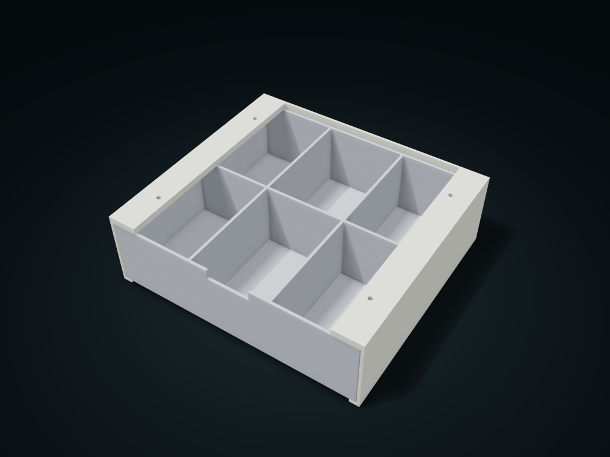

# Under-Desk Compartment Drawer

One-piece fixed twin rails stay aligned; drawer dividers and screw holes are adjustable.

**[Preview this model and customize it on boxesmodel](https://boxesmodel.com/models/under-desk-drawer)**

## Default model

| Property | Value |
| --- | --- |
| Category | Drawer Storage |
| Model version | 1.0.1 |
| Default assembly display size | 210 × 190 × 65 mm |
| Included parts | 2 |
| Formats | STL and STEP |
| Units | Millimeters |

Covers the layout of all parts in the current preview; see Files and dimensions for each part's print size.

## Dimensions and features

| Detail | Default value |
| --- | --- |
| Front and rear mounting hole center distance | 120.0 mm |
| Left and right mounting hole center distance | 178.0 mm |

## Download the parts

Open a file below and choose **Download raw file** on GitHub. STL is for slicers; STEP is for CAD editing.

| Part | Dimensions | STL | STEP |
| --- | --- | --- | --- |
| One-piece twin-rail fixed frame | 210 × 190 × 65 mm | [frame.stl](frame.stl) | [frame.step](frame.step) |
| Pull-out divided drawer | 204.4 × 186.8 × 56.8 mm | [drawer.stl](drawer.stl) | [drawer.step](drawer.step) |

Each listed part has its own STL and STEP file. Preview colors are illustrative; the manufacturing files do not contain the displayed colors.

## Printing and assembly

- Take the drawer out first, then fix the top to the underside of the desk with 4 of your own screws; set hole diameter with allowance for your actual screws; head diameter at most hole + 4 mm and head height no more than 3 mm.
- A one-piece rear beam keeps the two rails aligned; the drawer sits on the bottom rails and pulls fully forward, with no anti-pull-out lock; support it when removing.
- Confirm the desk board material, thickness and screw length so they do not go through the desktop; test-print to check fixing strength and drawer load first.
- Import at millimeter scale. Check your build volume, orientation, overhangs, supports and mating clearances in the slicer.

## Adjust the design

Visit the [interactive model page](https://boxesmodel.com/models/under-desk-drawer) to inspect the 3D model and adjust the available dimensions and layout options. This folder contains the default-size export shown above; custom exports follow the options and pricing shown on boxesmodel.

## License and attribution

Copyright © 2026 boxesmodel. These model files, preview and description are licensed under [CC BY 4.0](https://creativecommons.org/licenses/by/4.0/). You may share, modify and use them commercially with the required attribution. See the [full license](../../LICENSE) and [attribution guide](../../ATTRIBUTION.md).

Suggested credit:

> “Under-Desk Compartment Drawer” by [boxesmodel](https://boxesmodel.com/models/under-desk-drawer), licensed under [CC BY 4.0](https://creativecommons.org/licenses/by/4.0/). Indicate any changes you make.

[Browse all models](../../CATALOG.md) · [About the collection](../../README.md)
