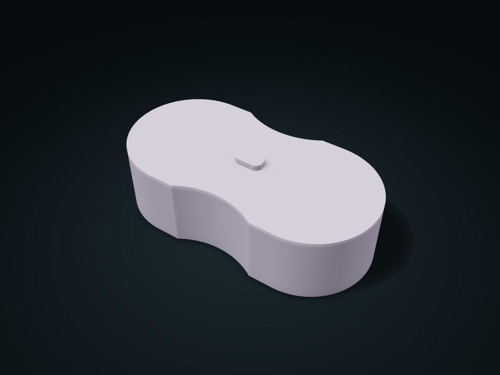

# Waisted Arc Lift-Off Case

Continuous circular arcs define the waisted arc lift-off case, with a solid floor and optional low compartments for daily organization.

**[Preview this model and customize it on boxesmodel](https://boxesmodel.com/models/waisted-arc-lift-case)**

## Default model

| Property | Value |
| --- | --- |
| Category | Desktop Organizers |
| Model version | 1.0.0 |
| Default assembly display size | 220 × 110 × 65 mm |
| Included parts | 2 |
| Formats | STL and STEP |
| Units | Millimeters |

Covers the layout of all parts in the current preview; see Files and dimensions for each part's print size.

## Dimensions and features

| Detail | Default value |
| --- | --- |
| Conservative Straight Clear Length per Compartment | 48.4 mm |
| Conservative Straight Clear Width per Compartment | 35.2 mm |
| Usable Interior Depth | 50.4 mm |

## Download the parts

Open a file below and choose **Download raw file** on GitHub. STL is for slicers; STEP is for CAD editing.

| Part | Dimensions | STL | STEP |
| --- | --- | --- | --- |
| Curved Outline Compartment Body | 220 × 110 × 57.2 mm | [body.stl](body.stl) | [body.step](body.step) |
| Matching Inset Ring Lid | 220 × 110 × 11.8 mm | [lid.stl](lid.stl) | [lid.step](lid.step) |

Each listed part has its own STL and STEP file. Preview colors are illustrative; the manufacturing files do not contain the displayed colors.

## Printing and assembly

- Insert items from above. Key dimensions describe conservative straight-through clearance; rounded corners, dividers and shaped ends also occupy space. Allow handling clearance for the widest part of each item.
- Key clearances describe conservative rectangular probe regions within curved pockets, not a full-outline rectangular box fit. Insert items separately from above when divided.
- The lid follows the inner outline and inserts by 4 mm. Design offset allowance is 0.45 mm; curved-edge gaps may be larger. Lift the grip vertically; the lid is neither sealed nor latched.
- All custom parts are included in the download; no purchased parts are required. Preview colors are for display only; manufacturing STL/STEP files are uncolored.
- Check overhangs, supports and fit before printing; support-free printing, load capacity, sealing and food-contact safety are not promised.
- Import at millimeter scale. Check your build volume, orientation, overhangs, supports and mating clearances in the slicer.

## Adjust the design

Visit the [interactive model page](https://boxesmodel.com/models/waisted-arc-lift-case) to inspect the 3D model and adjust the available dimensions and layout options. This folder contains the default-size export shown above; custom exports follow the options and pricing shown on boxesmodel.

## License and attribution

Copyright © 2026 boxesmodel. These model files, preview and description are licensed under [CC BY 4.0](https://creativecommons.org/licenses/by/4.0/). You may share, modify and use them commercially with the required attribution. See the [full license](../../LICENSE) and [attribution guide](../../ATTRIBUTION.md).

Suggested credit:

> “Waisted Arc Lift-Off Case” by [boxesmodel](https://boxesmodel.com/models/waisted-arc-lift-case), licensed under [CC BY 4.0](https://creativecommons.org/licenses/by/4.0/). Indicate any changes you make.

[Browse all models](../../CATALOG.md) · [About the collection](../../README.md)
