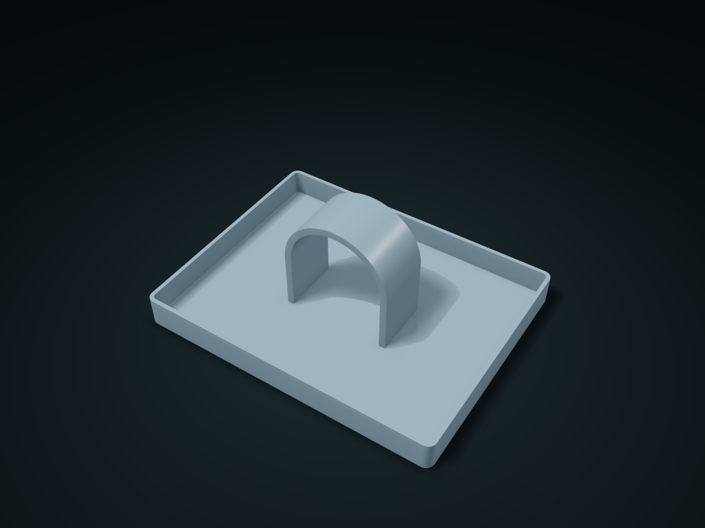

# Watch Strap Arch Box

Open the clasp and drape the strap over the arch, dial up, with spare straps and small items beside it. Adjust arch span, support width and side walls.

**[Preview this model and customize it on boxesmodel](https://boxesmodel.com/models/watch-arch-caddy)**

## Default model

| Property | Value |
| --- | --- |
| Category | Desktop Organizers |
| Model version | 1.0.0 |
| Default box size | 180 × 140 × 70 mm |
| Included parts | 1 |
| Formats | STL and STEP |
| Units | Millimeters |

Dimensions include the outer outline of the box; see the specifications for usable interior space.

## Intended use

- For watches, spare straps and small accessories. Open the clasp before placement or removal; do not force a strap around too small a radius.
- One piece, no hardware. The inside of the arch has an overhang; check print supports in the slicer.

## Dimensions and features

| Detail | Default value |
| --- | --- |
| Use | An arched strap support raises the watch face, with open compartments on both sides for accessories |

## Download the parts

Open a file below and choose **Download raw file** on GitHub. STL is for slicers; STEP is for CAD editing.

| Part | Dimensions | STL | STEP |
| --- | --- | --- | --- |
| Watch Strap Arch Box | 180 × 140 × 70 mm | [body.stl](body.stl) | [body.step](body.step) |

Each listed part has its own STL and STEP file. Preview colors are illustrative; the manufacturing files do not contain the displayed colors.

## Printing and assembly

- The strap wraps over the arch with the watch face up; unfasten the buckle before putting it on or taking it off; compartments on both sides hold spare watch straps and small items.
- One-piece structure with no hardware; check slicing supports for the overhanging sections inside the arch; do not force the strap to too small a radius.
- Import at millimeter scale. Check your build volume, orientation, overhangs, supports and mating clearances in the slicer.

## Adjust the design

Visit the [interactive model page](https://boxesmodel.com/models/watch-arch-caddy) to inspect the 3D model and adjust the available dimensions and layout options. This folder contains the default-size export shown above; custom exports follow the options and pricing shown on boxesmodel.

## License and attribution

Copyright © 2026 boxesmodel. These model files, preview and description are licensed under [CC BY 4.0](https://creativecommons.org/licenses/by/4.0/). You may share, modify and use them commercially with the required attribution. See the [full license](../../LICENSE) and [attribution guide](../../ATTRIBUTION.md).

Suggested credit:

> “Watch Strap Arch Box” by [boxesmodel](https://boxesmodel.com/models/watch-arch-caddy), licensed under [CC BY 4.0](https://creativecommons.org/licenses/by/4.0/). Indicate any changes you make.

[Browse all models](../../CATALOG.md) · [About the collection](../../README.md)
