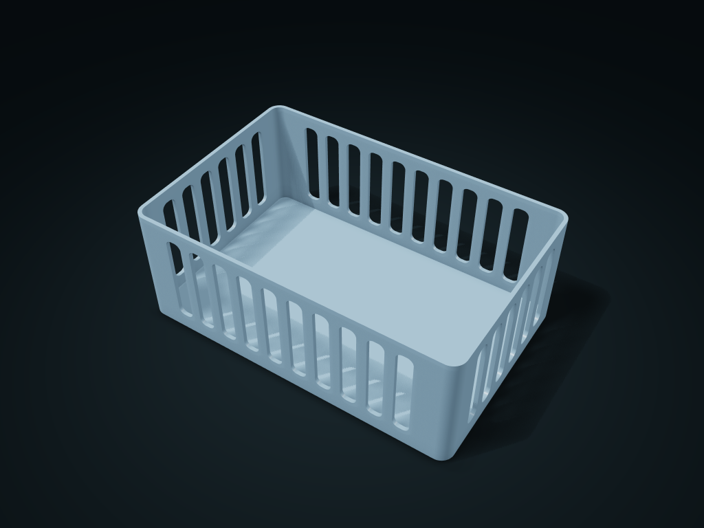

# Cut-Out Storage Box

A complete floor with rounded cut-outs makes a light design of its own.

**[Preview this model and customize it on boxesmodel](https://boxesmodel.com/models/window-box)**

## Default model

| Property | Value |
| --- | --- |
| Category | Open Storage |
| Model version | 1.1.0 |
| Default box size | 200 × 130 × 75 mm |
| Included parts | 1 |
| Formats | STL and STEP |
| Units | Millimeters |

Dimensions include the outer outline of the box; see the specifications for usable interior space.

## Dimensions and features

| Detail | Default value |
| --- | --- |
| Interior layout | 1 × 1, 1 cell in total |
| Straight-side clear length × width per cell | 195.2 × 125.2 mm |

## Download the parts

Open a file below and choose **Download raw file** on GitHub. STL is for slicers; STEP is for CAD editing.

| Part | Dimensions | STL | STEP |
| --- | --- | --- | --- |
| Cut-Out Storage Box | 200 × 130 × 75 mm | [window-box.stl](window-box.stl) | [window-box.step](window-box.step) |

Each listed part has its own STL and STEP file. Preview colors are illustrative; the manufacturing files do not contain the displayed colors.

## Printing and assembly

- The cut-outs keep a continuous floor and upper and lower frame edges; test-print to check strength for your actual use.
- Dividers are fixed in one piece; with both rows and columns at 1 there are no cells; small items may still fall out through the outer wall openings.
- Import at millimeter scale. Check your build volume, orientation, overhangs, supports and mating clearances in the slicer.

## Adjust the design

Visit the [interactive model page](https://boxesmodel.com/models/window-box) to inspect the 3D model and adjust the available dimensions and layout options. This folder contains the default-size export shown above; custom exports follow the options and pricing shown on boxesmodel.

## License and attribution

Copyright © 2026 boxesmodel. These model files, preview and description are licensed under [CC BY 4.0](https://creativecommons.org/licenses/by/4.0/). You may share, modify and use them commercially with the required attribution. See the [full license](../../LICENSE) and [attribution guide](../../ATTRIBUTION.md).

Suggested credit:

> “Cut-Out Storage Box” by [boxesmodel](https://boxesmodel.com/models/window-box), licensed under [CC BY 4.0](https://creativecommons.org/licenses/by/4.0/). Indicate any changes you make.

[Browse all models](../../CATALOG.md) · [About the collection](../../README.md)
