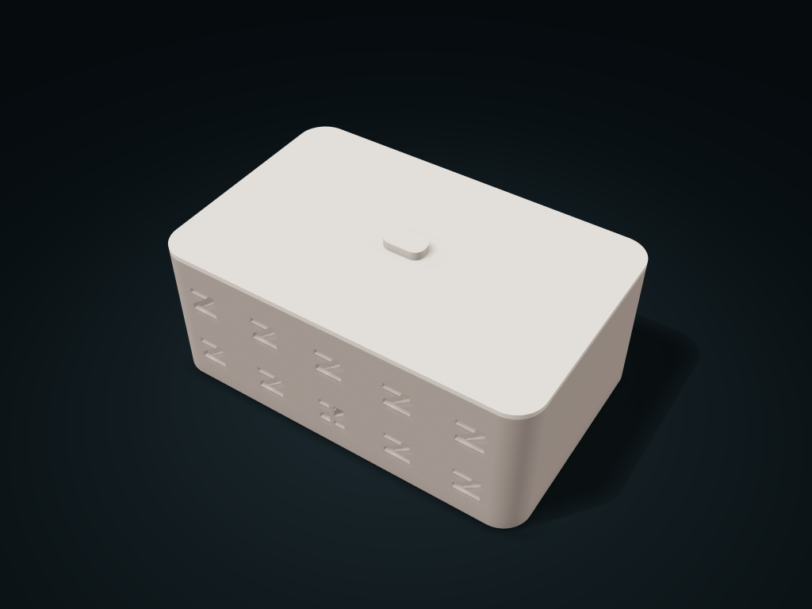

# Z Ribbon Window Lift-Off Box

Independently drawn z ribbon window motifs with a rounded solid base and configurable low compartments.

**[Preview this model and customize it on boxesmodel](https://boxesmodel.com/models/z-ribbon-lift-box)**

## Default model

| Property | Value |
| --- | --- |
| Category | Desktop Organizers |
| Model version | 1.0.0 |
| Default assembly display size | 215 × 138 × 90 mm |
| Included parts | 2 |
| Formats | STL and STEP |
| Units | Millimeters |

Covers the layout of all parts in the current preview; see Files and dimensions for each part's print size.

## Dimensions and features

| Detail | Default value |
| --- | --- |
| Conservative Straight Clear Length per Compartment | 87.3 mm |
| Conservative Straight Clear Width | 106.0 mm |
| Usable Interior Depth | 75.4 mm |

## Download the parts

Open a file below and choose **Download raw file** on GitHub. STL is for slicers; STEP is for CAD editing.

| Part | Dimensions | STL | STEP |
| --- | --- | --- | --- |
| Patterned Shared-Wall Body | 215 × 138 × 82.2 mm | [body.stl](body.stl) | [body.step](body.step) |
| Rounded Locating Ring Lid | 215 × 138 × 11.8 mm | [lid.stl](lid.stl) | [lid.step](lid.step) |

Each listed part has its own STL and STEP file. Preview colors are illustrative; the manufacturing files do not contain the displayed colors.

## Printing and assembly

- Insert items from above. Key dimensions describe conservative straight-through clearance; rounded corners, dividers and shaped ends also occupy space. Allow handling clearance for the widest part of each item.
- The kit contains a body and a lift-off lid. The locating ring inserts vertically by 4 mm with nominal clearance 0.45 mm per side. The lid rests on the rim; lift the rounded top grip to remove it. It is not sealed or locked.
- The wall openings pass through; keep small items in inner packaging; the base is solid, but this model makes no watertightness, drainage, or food-contact claim.
- All custom parts are included in the download; no purchased parts are required. Preview colors are for display only; manufacturing STL/STEP files are uncolored.
- Check overhangs, supports and fit before printing; support-free printing, load capacity, sealing and food-contact safety are not promised.
- Import at millimeter scale. Check your build volume, orientation, overhangs, supports and mating clearances in the slicer.

## Adjust the design

Visit the [interactive model page](https://boxesmodel.com/models/z-ribbon-lift-box) to inspect the 3D model and adjust the available dimensions and layout options. This folder contains the default-size export shown above; custom exports follow the options and pricing shown on boxesmodel.

## License and attribution

Copyright © 2026 boxesmodel. These model files, preview and description are licensed under [CC BY 4.0](https://creativecommons.org/licenses/by/4.0/). You may share, modify and use them commercially with the required attribution. See the [full license](../../LICENSE) and [attribution guide](../../ATTRIBUTION.md).

Suggested credit:

> “Z Ribbon Window Lift-Off Box” by [boxesmodel](https://boxesmodel.com/models/z-ribbon-lift-box), licensed under [CC BY 4.0](https://creativecommons.org/licenses/by/4.0/). Indicate any changes you make.

[Browse all models](../../CATALOG.md) · [About the collection](../../README.md)
